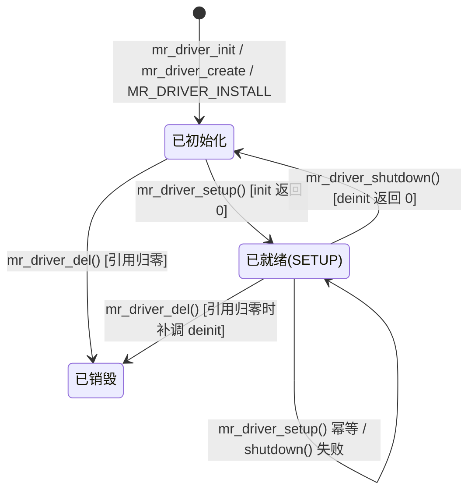

# 驱动框架（Driver）

为所有外设驱动提供统一的对象模型、注册查找机制、生命周期管理（`setup`/`shutdown`/
`del`）与引用计数，是 `mrX/drivers/` 下各具体外设驱动的公共基座。

| 项目   | 说明                                                                                                                       |
|--------|----------------------------------------------------------------------------------------------------------------------------|
| 功能宏 | `MR_USE_DRIVER`                                                                                                            |
| 头文件 | `<mrX/drivers/mr_driver.h>`                                                                                                |
| 依赖   | [对象 Object](../kernel/object.md)、[等待队列 Wait](../kernel/wait.md)、[动态内存 Malloc](../libc/malloc.md)（仅动态创建） |
| 测试   | `test/drivers/driver.c`                                                                                                    |

## 配置

| 配置项          | 类型 | 默认值 | 说明                                                                |
|-----------------|------|--------|---------------------------------------------------------------------|
| `MR_USE_DRIVER` | bool | n      | 启用驱动框架，自动 `select MR_USE_WAIT`；所有具体外设驱动均依赖此项 |

## 快速上手

定义一个驱动并通过 `MR_DRIVER_INSTALL` 注册到系统初始化序列：

```c
#include <mrX/drivers/mr_driver.h>

static mr_err_t my_init(const mr_driver_t *drv) {
    /* 上电 / 配置硬件 */
    return 0;
}

static mr_err_t my_deinit(const mr_driver_t *drv) {
    /* 下电 */
    return 0;
}

static const mr_driver_clazz_t my_clazz = MR_DRIVER_CLAZZ_INIT(
    "my_driver", my_init, my_deinit, MR_NULL);

/* 定义对象并注册到 "3" (normal) 自动启动段，名称为 "my_dev" */
MR_DRIVER_INSTALL(my_dev, &my_clazz, MR_DRIVER_TYPE_RAM,
                  MR_NULL, MR_NULL, MR_NULL, MR_DRIVER_LEVEL_NORMAL);
```

在应用代码中按名称查找并使用：

```c
mr_driver_t *drv = mr_driver_find("my_dev");
if (drv != MR_NULL) {
    /* 使用 drv ... */
    mr_driver_put(drv); /* 释放 mr_driver_find 持有的引用 */
}
```

## 核心机制与约束

### 生命周期



- **静态与动态**：静态对象通过 `MR_DRIVER_INSTALL` / `MR_DRIVER_DEFINE`（编译期）或
  `mr_driver_init`（运行期）初始化，`mr_driver_del` 反初始化但不释放内存；动态对象通过
  `mr_driver_create` 在堆上分配，`mr_driver_del` 会在引用归零时释放对象内存。
- **引用计数**：`mr_driver_find` 返回时已调用 `mr_driver_get` 增加引用计数，使用完毕必须调用
  `mr_driver_put` 归还。若在仍有外部引用时调用 `mr_driver_del`，对象会标记
  `MR_DRIVER_FLAG_DYING`，实际的 `deinit` 补调与 `release` 推迟到最后一个引用归还时执行。

### 运行期行为约定

| 场景                                                   | 行为                                                                                                       |
|--------------------------------------------------------|------------------------------------------------------------------------------------------------------------|
| 对已 setup 的驱动再次 `mr_driver_setup`                | 幂等，直接将状态清 0 并返回 0，不重复执行 `init`                                                           |
| 对未 setup 的驱动调用 `mr_driver_shutdown`             | 安全返回 0，不执行 `deinit`                                                                                |
| 并发对同一驱动执行 `setup`/`shutdown`                  | 后到者原子抢锁失败，立即返回 `-MR_EBUSY`，不阻塞等待                                                       |
| 对已调用 `mr_driver_del` 的驱动执行 `setup`/`shutdown` | 返回 `-MR_EPERM`                                                                                           |
| `clazz` 未提供 `init` 或 `deinit`                      | 视为无需硬件操作，直接成功并更新 `SETUP` 标志                                                              |
| `init` 返回非 0                                        | `setup` 返回该错误码，驱动保持未 setup，错误码写入 `state`                                                 |
| `deinit` 返回非 0                                      | `shutdown` 返回该错误码，驱动保持 `SETUP` 标志，错误码写入 `state`（`mr_driver_is_ready` 返回 `MR_FALSE`） |

### 初始化级别

`MR_DRIVER_INSTALL` 的 `_level` 参数决定自动启动顺序，链接脚本按段名字符串字典序收集并依次执行：

| 级别宏                    | 段名后缀 | 自动启动 | 说明                                                              |
|---------------------------|----------|----------|-------------------------------------------------------------------|
| `MR_DRIVER_LEVEL_EARLY`   | `"1"`    | 是       | 最早初始化（如时钟、核心总线控制器）                              |
| `MR_DRIVER_LEVEL_PRIO(x)` | `"2." x` | 是       | 按子级别字符串升序启动                                            |
| `MR_DRIVER_LEVEL_NORMAL`  | `"3"`    | 是       | 常规外设默认级别                                                  |
| `MR_DRIVER_LEVEL_LAST`    | `"4"`    | 是       | 依赖前置外设的驱动                                                |
| `MR_DRIVER_LEVEL_DEFER`   | `"9"`    | 否       | 延迟启动，`mr_drivers_driver_init` 跳过，需手动 `mr_driver_setup` |

### 并发与上下文约束

- `setup`/`shutdown` 互斥依赖 `flags` 上的原子 CAS 锁（`MR_DRIVER_FLAG_LOCK`），因此
  **禁止在 `init`/`deinit` 回调内部再次对同一驱动调用 `setup`/`shutdown`**（会返回
  `-MR_EBUSY`）。
- `init`/`deinit` 在调用者当前上下文同步执行；系统自动启动阶段运行在内核初始化流程（
  `MR_INIT_LEVEL_DRIVER`）中。
- 动态创建、最后一次 `mr_driver_put` 触发 `deinit`/`release`/`mr_free`
  时均不可在中断上下文中调用。
- 具体外设操作 API 入口通过 `MR_DRIVER_ASSERT` 校验指针非空、已 setup 且主类型（
  `type & MR_DRIVER_TYPE_MASK`）匹配；类型化 `*_del` 入口使用
  `MR_DRIVER_ASSERT_TYPE`（不要求已 setup）。

## API 速查

### 生命周期与注册

| API                                                                    | 说明                                            |
|------------------------------------------------------------------------|-------------------------------------------------|
| `MR_DRIVER_INIT(_drv, _dclazz, _type, _data, _priv, _ops)`             | 静态初始化驱动对象结构体                        |
| `MR_DRIVER_DEFINE(_name, _dclazz, _type, _data, _priv, _ops)`          | 定义静态驱动对象（不放入查找段）                |
| `MR_DRIVER_INSTALL(_name, _dclazz, _type, _data, _priv, _ops, _level)` | 定义驱动对象并安装到自动启动/查找段             |
| `mr_driver_init(drv, dclazz, type, data, priv, ops)`                   | 运行时初始化静态驱动对象，成功返回 0            |
| `mr_driver_create(dclazz, type, data, priv, ops)`                      | 堆上动态创建驱动对象，失败返回 `MR_NULL`        |
| `mr_driver_del(drv)`                                                   | 注销并删除驱动（置 `DYING` 标志并释放初始引用） |
| `mr_driver_setup(drv)`                                                 | 执行 `init` 回调并标记 setup                    |
| `mr_driver_shutdown(drv)`                                              | 执行 `deinit` 回调并清除 setup 标记             |

### 查找、引用与状态查询

| API                                                                     | 说明                                                                              |
|-------------------------------------------------------------------------|-----------------------------------------------------------------------------------|
| `mr_driver_find(name)`                                                  | 按名称线性扫描注册段查找驱动，命中则返回已 `get` 引用的指针，未找到返回 `MR_NULL` |
| `mr_driver_get(drv)` / `mr_driver_put(drv)`                             | 引用计数加一 / 减一                                                               |
| `MR_DRIVER_FIND(_name)`                                                 | 按编译期符号名直接取静态驱动对象地址（不增加引用计数）                            |
| `MR_DRIVER_EXPORT(_name)` / `MR_DRIVER_IMPORT(_name)`                   | 跨文件导出 / 导入静态驱动对象符号                                                 |
| `mr_driver_is_ready(drv)`                                               | 驱动非空、已初始化、已 setup、未处于 `DYING` 且 `state == 0` 时返回 `MR_TRUE`     |
| `mr_driver_type(drv)` / `MR_DRIVER_TYPE(_drv)`                          | 读取完整驱动类型值                                                                |
| `MR_DRIVER_IS_TYPE(_drv, _type)`                                        | 精确比较完整类型值                                                                |
| `mr_driver_state(drv)` / `mr_driver_state_set(drv, errcode)`            | 读取 / 设置驱动错误状态（`errcode <= 0`）                                         |
| `MR_DRIVER_IS_SETUP(_drv)` / `MR_DRIVER_IS_DYING(_drv)`                 | 查询 `SETUP` / `DYING` 标志位                                                     |
| `MR_DRIVER_ASSERT_TYPE(_drv, _type)` / `MR_DRIVER_ASSERT(_drv, _type)`  | 校验驱动对象及主类型（后者额外要求已 setup）                                      |
| `MR_DRIVER_DATA(_drv)` / `MR_DRIVER_PRIV(_drv)` / `MR_DRIVER_OPS(_drv)` | 获取 `data`、`priv`、`ops` 指针                                                   |

### Clazz 与 HardTree 辅助

| API                                                                    | 说明                                                                                     |
|------------------------------------------------------------------------|------------------------------------------------------------------------------------------|
| `MR_DRIVER_CLAZZ_INIT(_name, _init, _deinit, _release)`                | 静态初始化 `mr_driver_clazz_t`                                                           |
| `mr_driver_clazz_init(dclazz, name, init, deinit, release)`            | 运行时初始化 `mr_driver_clazz_t`                                                         |
| `MR_DRIVER_CLAZZES_DEFINE(_name, _init, _deinit, _release)`            | 定义静态/动态双通道 `mr_driver_clazzes_t`（静态通道 `release` 固定为 `MR_NULL`）         |
| `MR_DRIVER_CLAZZES_EXPORT(_name)` / `MR_DRIVER_CLAZZES_IMPORT(_name)`  | 跨文件导出 / 导入双通道 clazzes                                                          |
| `MR_DRIVER_CLAZZES_STATIK(_name)` / `MR_DRIVER_CLAZZES_DYNAMIC(_name)` | 获取静态 / 动态通道 clazz 指针                                                           |
| `MR_HT_DRIVER_INSTALL(_id, _dclazz, _type, _data, _priv, _ops)`        | 从 HardTree 节点安装驱动实例（级别取 `INIT_LEVEL` 属性，缺省为 `MR_DRIVER_LEVEL_DEFER`） |
| `MR_HT_DRIVER_FIND(_node)`                                             | 通过 HardTree 节点名取驱动对象地址                                                       |

## 内部实现

### 分层与启动段布局

```text
应用 / 文件系统 / 上层模块
        │  mr_driver_find() / 类型化外设 API
        ▼
具体外设驱动层（gpio / uart / i2c / spi / ...） ──▶ ops 硬件操作表
        │  mr_driver_setup() / shutdown() / del()
        ▼
驱动框架 Driver（mr_driver_t：对象引用计数 + 原子状态锁 + 注册段扫描）
```

- `drivers/driver.c` 在 `mr_driver.*` 段中定义了三个内部边界占位条目：`start`（
  `"0.end"`）、`defer`（`"8.end"`）、`end`（`"9.end"`）。
- 链接脚本通过 `KEEP(*(SORT(mr_driver.*)))` 按级别排序后，内核在
  `MR_INIT_LEVEL_DRIVER` 阶段执行 `mr_drivers_driver_init`，遍历 `(start, defer)`
  区间自动调用 `mr_driver_setup` 并断言返回 0；`MR_DRIVER_LEVEL_DEFER`（`"9"`）落在
  `(defer, end)` 之间，不参与自动启动。
- `mr_driver_find` 线性扫描 `(start, end)` 区间，命中 `defer` 占位时返回
  `MR_NULL`。

### 子模块派生约定

1. 各外设子模块使用 `MR_DRIVER_CLAZZES_DEFINE` 定义自己的静态/动态 clazz（例如在
   `init`/`deinit` 中初始化或销毁 `mr_waitable_t`，在动态 `release` 中释放 `data`
   模型数据）。
2. 在头文件中提供类型化 `MR_INLINE` 包装函数（如 `mr_gpio_init`、`mr_uart_create`
   ），固定传入对应的 `MR_DRIVER_TYPE_*` 主类型（`MR_DRIVER_TYPE_MASK = 0xff00`
   ）与子模块 clazz。
3. 平台 backend 在源文件定义 `MR_HT_COMPAT` 后，通过 `MR_HT_DRIVER_INSTALL`
   批量实例化驱动；`<mrX/drivers/mr_driver.h>` 会自动为所有 `DRIVER` 兼容组实例生成
   `MR_DRIVER_EXPORT` 声明。

## 子模块索引

跨外设联动顺序见 [驱动组合与进阶示例](examples.md)，I2C/SPI
外扩芯片通用约束见 [串行总线外扩驱动共同行为](serial_peripheral.md)。

| 驱动     | 用户文档                                                                                                                                                                                                                                                                                                                          | 移植文档                       | 主类型                 |
|----------|-----------------------------------------------------------------------------------------------------------------------------------------------------------------------------------------------------------------------------------------------------------------------------------------------------------------------------------|--------------------------------|------------------------|
| GPIO     | [gpio.md](gpio/gpio.md)                                                                                                                                                                                                                                                                                                           | [porting.md](gpio/porting.md)  | `MR_DRIVER_TYPE_GPIO`  |
| UART     | [uart.md](uart/uart.md)                                                                                                                                                                                                                                                                                                           | [porting.md](uart/porting.md)  | `MR_DRIVER_TYPE_UART`  |
| I2C      | [i2c.md](i2c/i2c.md)                                                                                                                                                                                                                                                                                                              | [porting.md](i2c/porting.md)   | `MR_DRIVER_TYPE_I2C`   |
| SPI      | [spi.md](spi/spi.md)                                                                                                                                                                                                                                                                                                              | [porting.md](spi/porting.md)   | `MR_DRIVER_TYPE_SPI`   |
| ADC      | [adc.md](adc/adc.md)                                                                                                                                                                                                                                                                                                              | [porting.md](adc/porting.md)   | `MR_DRIVER_TYPE_ADC`   |
| DAC      | [dac.md](dac/dac.md)                                                                                                                                                                                                                                                                                                              | [porting.md](dac/porting.md)   | `MR_DRIVER_TYPE_DAC`   |
| DMA      | [dma.md](dma/dma.md)                                                                                                                                                                                                                                                                                                              | [porting.md](dma/porting.md)   | `MR_DRIVER_TYPE_DMA`   |
| TMR      | [tmr.md](tmr/tmr.md)                                                                                                                                                                                                                                                                                                              | [porting.md](tmr/porting.md)   | `MR_DRIVER_TYPE_TMR`   |
| PWM      | [pwm.md](pwm/pwm.md)                                                                                                                                                                                                                                                                                                              | [porting.md](pwm/porting.md)   | `MR_DRIVER_TYPE_PWM`   |
| WDT      | [wdt.md](wdt/wdt.md)                                                                                                                                                                                                                                                                                                              | [porting.md](wdt/porting.md)   | `MR_DRIVER_TYPE_WDT`   |
| FLASH    | [flash.md](flash/flash.md)                                                                                                                                                                                                                                                                                                        | [porting.md](flash/porting.md) | `MR_DRIVER_TYPE_FLASH` |
| RAM      | [ram.md](ram/ram.md)                                                                                                                                                                                                                                                                                                              | [porting.md](ram/porting.md)   | `MR_DRIVER_TYPE_RAM`   |
| ETH      | —                                                                                                                                                                                                                                                                                                                                 | —                              | `MR_DRIVER_TYPE_ETH`   |
| 扩展芯片 | [HC165](gpio/gpio_hc165.md) / [HC595](gpio/gpio_hc595.md) / [PCF8574](gpio/gpio_pcf8574.md) / [MCP23x17](gpio/gpio_mcp23x17.md) / [PCA9555](gpio/gpio_pca9555.md) / [ADS1x15](adc/adc_ads1x15.md) / [MCP3008](adc/adc_mcp3008.md) / [MCP4725](dac/dac_mcp4725.md) / [MCP4922](dac/dac_mcp4922.md) / [PCA9685](pwm/pwm_pca9685.md) | —                              | 复用对应总线/外设驱动  |
