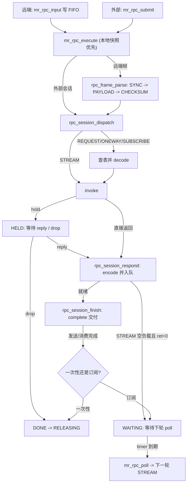

# 远程过程调用（RPC）

基于二进制帧协议的轻量远程过程调用框架：对端发起请求帧，本机按 `service/method`
查表分发到方法入口并回送响应；同时支持单向消息、周期性订阅推送与本地外部会话提交。方法参数与返回值的编解码由
IDL 工具链从 `.idl` 描述文件自动生成。

| 项目   | 说明                                                                                                                                                                                           |
|--------|------------------------------------------------------------------------------------------------------------------------------------------------------------------------------------------------|
| 功能宏 | `MR_USE_MODULE_RPC`（可选 `MR_USE_MODULE_RPC_HOOK`、`MR_USE_MODULE_RPC_SELF_DESC`）                                                                                                            |
| 头文件 | `<mrX/modules/rpc/mr_rpc.h>`                                                                                                                                                                   |
| 依赖   | [FIFO](../../kernel/fifo.md)、[哈希表](../../kernel/hashmap.md)、[软定时器](../../kernel/timer.md)、[对象系统](../../kernel/object.md)、[内存分配](../../libc/malloc.md)（仅 `mr_rpc_create`） |
| 测试   | `test/modules/rpc/rpc.c`、`test/modules/rpc/rpc.idl`                                                                                                                                           |

## 配置

| 配置项                            | 类型 | 默认值 | 说明                                                              |
|-----------------------------------|------|--------|-------------------------------------------------------------------|
| `MR_USE_MODULE_RPC`               | bool | n      | 启用 RPC 核心（自动选中 `MR_USE_TIMER`）                          |
| `MR_USE_MODULE_RPC_HOOK`          | bool | n      | 启用执行器 `wakeup`/`suspend` 事件钩子                            |
| `MR_USE_MODULE_RPC_SELF_DESC`     | bool | n      | 将编译后的 IDL 描述嵌入 ROM 并自动注册自描述读取方法              |
| `MR_CFG_RPC_SELF_DESC_CHUNK_SIZE` | int  | 128    | 单次自描述响应最大负载字节数，范围 16~1024                        |
| `MR_CFG_RPC_CALL_BUCKET_NUM`      | int  | 16     | 方法哈希表桶数，范围 1~1024                                       |
| `MR_CFG_MODULE_RPC_SESSION_NUM`   | int  | 1      | 预分配远端会话数，范围 1~1024（头文件回退值 2）；订阅至少需配置 2 |
| `MR_CFG_MODULE_RPC_FIFO_SIZE`     | int  | 256    | 接收 FIFO 字节数，范围 24~1048576（至少容纳 24 字节帧头）         |

## 快速上手

### 1. 定义 IDL 并生成编解码代码

在 `.idl`
文件中声明服务与方法（完整语法与参数说明见 [RPC IDL 脚本指南](../../scripts/rpc-idl/rpc-idl.md)）：

```idl
service calculator @1 {
    add  @0 (left: i32, right: i32) -> (sum: i32);
    echo @1 (message: u8<48>) -> (message: u8<48>);
};
```

在仓库根目录执行工具链生成头文件 `mr_rpc_idl.h` 与编解码源文件 `idl.c`
（不要手动编辑生成文件）：

```bash
python ./scripts/cli.py rpc-idl -i ./app/rpc/calculator.idl -o ./app/generated/include/mrX/modules/rpc -c ./app/generated/rpc_idl.c --no-cpp
```

### 2. 实现方法入口并驱动收发

`<mrX/modules/rpc/mr_rpc.h>` 会自动引入生成的 `mr_rpc_idl.h`，使用前需先通过
`mr_user_init()` 完成模块级方法表注册：

```c
#include <mrX/modules/rpc/mr_rpc.h>
#include <mrX/libc/mr_string.h>

static mr_rpc_t rpc;

static mr_ssize_t my_send(void *priv, const void *buf, mr_uint32_t size) {
    /* 返回实际接受字节数；返回 0 表示传输忙，负数表示错误 */
    return transport_write(priv, buf, size);
}

static const mr_rpc_ops_t my_ops = {
    .send = my_send,
    .flush = MR_NULL,
};

MR_RPC(calculator, add) {
    response->sum = request->left + request->right;
    return 0; /* 非负返回值作为结果码，框架自动编码 response */
}

MR_RPC(calculator, echo) {
    response->message.size = request->message.size;
    mr_memcpy(response->message.data, request->message.data, request->message.size);
    return 0;
}

mr_err_t rpc_setup(void *transport) {
    return mr_rpc_init(&rpc, &my_ops, transport);
}

/* 主循环或调度线程中调用 */
mr_ssize_t rpc_pump(const void *rx_buf, mr_uint32_t rx_size) {
    mr_ssize_t accepted = 0;
    if (rx_size != 0U) {
        accepted = mr_rpc_input(&rpc, rx_buf, rx_size);
    }
    (void)mr_rpc_execute(&rpc);
    (void)mr_rpc_poll(&rpc);
    return accepted;
}
```

## 核心机制与约束

### 帧协议与消息类型

帧由 24 字节紧凑头部、变长负载与可选 2 字节尾部校验组成；多字节字段按宿主字节序原样传输（不做大小端转换）：

| 偏移 | 字段           | 类型  | 说明                                                                           |
|------|----------------|-------|--------------------------------------------------------------------------------|
| 0    | `header[2]`    | u8[2] | 同步字 `'M'`、`'R'`                                                            |
| 2    | `version`      | u8    | 发送端固定填 `1`                                                               |
| 3    | `type`         | u8    | 消息类型（见下表）                                                             |
| 4    | `flags`        | u16   | `MR_RPC_FRAME_FLAG_CHECKSUM`（bit0）：负载后附 Fletcher-16 校验尾              |
| 6    | `hdr_checksum` | u16   | 头部 Fletcher-16 校验值（计算时本字段按 `0` 处理）                             |
| 8    | `session`      | u32   | 会话 ID，由发起方分配，响应原样回传                                            |
| 12   | `service`      | u16   | 服务 ID                                                                        |
| 14   | `method`       | u16   | 方法 ID                                                                        |
| 16   | `payload_size` | u32   | 负载字节数                                                                     |
| 20   | `value`        | u32   | 联合字段：订阅周期（ms，bit31 为连续标志）或响应结果码                         |
| 24   | `payload`      | 变长  | IDL 编码负载；定长数组 `T[N]` 无前缀，变长数组 `T<N>` 带元素计数前缀并校验上限 |
| 尾部 | `checksum`     | u16   | 负载 Fletcher-16 校验和（仅 `flags` bit0 置位时存在）                          |

| 消息类型                 | 方向 | 语义                                                  |
|--------------------------|------|-------------------------------------------------------|
| `MR_RPC_MSG_REQUEST`     | 请求 | 调用方法并返回 `RESPONSE` 帧                          |
| `MR_RPC_MSG_RESPONSE`    | 响应 | 本机发送器生成；输入侧解析后不作为可执行请求分发      |
| `MR_RPC_MSG_ONEWAY`      | 请求 | 调用方法但不回送任何响应帧                            |
| `MR_RPC_MSG_SUBSCRIBE`   | 请求 | 建立周期性订阅，应答后按 `value` 周期推送 `STREAM` 帧 |
| `MR_RPC_MSG_UNSUBSCRIBE` | 请求 | 按 `session` ID 退订（负载必须为空）                  |
| `MR_RPC_MSG_STREAM`      | 推送 | 本机订阅发送器生成；输入侧解析后不作为可执行请求分发  |

### 方法入口、延迟应答与订阅

- **全局方法表**：`MR_RPC_EXPORT` 将方法放入 `mr_rpc` 链接段，由
  `MR_INIT_LEVEL_MODULE` 阶段的 user-initcall 构建哈希表，因此必须在执行
  `mr_user_init()` 后才能分发请求。
- **结果码语义**：`MR_RPC(service, method)` 返回非负值时自动打包 `response`
  ；返回负数时丢弃 `response` 并回送空负载错误帧。
- **延迟应答（Hold）**：方法内可调用 `mr_rpc_session_hold(session)`
  脱离入口延迟处理，后续在任意上下文通过 `mr_rpc_session_reply(session, result)`
  应答或 `mr_rpc_session_drop(session)` 静默放弃。成功 `reply` 后不得再访问该会话。
- **订阅机制**：`SUBSCRIBE` 的周期为 `0` 返回 `-MR_EINVAL`；置位
  `MR_RPC_SUBSCRIBE_CONTINUOUS`（bit31）后每轮 `STREAM` 发送完成即重新入队等待下次
  `mr_rpc_poll()`。若某轮 `STREAM` 返回 `0` 且编码后语义负载为空（如全部变长数组
  `.size == 0`），该轮不发送空帧并直接等待下一周期。每个订阅永久占用一个内部会话，因此单会话配置（
  `SESSION_NUM == 1`）无法接受订阅。

### 外部 Session、自描述与钩子

- **外部 Session**：本地组件或 XVM 可通过 `mr_rpc_session_init()` 填写 `request`（
  `REQUEST`/`ONEWAY`/`SUBSCRIBE`）并调用 `mr_rpc_submit()` 提交给执行器（优先级高于远端
  FIFO）。结果通过 `ops->complete` 交付，调用方读取后调用
  `mr_rpc_session_consume()` 消费（一次性请求随后触发 `ops->release`
  回收，订阅则继续下一轮），或调用 `mr_rpc_session_cancel()` 取消。
- **自描述（Self-Desc）**：启用 `MR_USE_MODULE_RPC_SELF_DESC` 后，`idl.c` 会嵌入
  `MRID` 开头的二进制描述并自动导出内部查询方法；Host 从 `offset = 0` 开始分片拉取（每片最多
  `MR_CFG_RPC_SELF_DESC_CHUNK_SIZE` 字节），直至收到 0 字节响应。
- **执行器钩子（Hook）**：启用 `MR_USE_MODULE_RPC_HOOK` 后可通过
  `mr_rpc_hook_set()` 注册 `wakeup`/`suspend` 回调，分别针对
  `MR_RPC_EVENT_EXECUTE` 和 `MR_RPC_EVENT_POLL` 独立上报，推荐配合初始值为 0
  的信号量驱动工作线程。

### 生命周期、并发与传输约束

- **对象生命周期**：`ops`、`priv` 与 `hook` 仅保存指针，须在最终 release 前保持有效；
  `mr_rpc_del()` 先置 `dying` 拒绝新工作并归还初始引用，若存在 `hold`
  住的会话或外部引用，最终释放延后至最后一个引用归还。
- **传输忙与续发**：`ops->send` 返回 `0` 时，未发完的帧保留在发送游标中，
  `mr_rpc_execute()` 返回 `-MR_EAGAIN`，后续调用 `mr_rpc_flush()` 续发（已发字节不重发）。
- **并发与中断安全**：RPC 不自建线程；`mr_rpc_execute()` 的帧解析阶段不可重入，同一
  RPC 对象的 `execute`/`poll`/`flush` 应串行驱动。`mr_rpc_input()` 仅在满足 FIFO
  单生产者约束且同步 `hook->wakeup` 允许当前上下文时才可调用。

## API 速查

| 分组       | API                                              | 说明                                                               |
|------------|--------------------------------------------------|--------------------------------------------------------------------|
| 生命周期   | `mr_rpc_init(rpc, ops, priv)`                    | 初始化静态 RPC 对象（仅外部 session 时 `ops` 可为 `MR_NULL`）      |
| 生命周期   | `mr_rpc_create(ops, priv)`                       | 动态分配并初始化 RPC 对象                                          |
| 生命周期   | `mr_rpc_del(rpc)`                                | 置 `dying` 并归还初始引用                                          |
| 生命周期   | `mr_rpc_get(rpc)` / `mr_rpc_put(rpc)`            | 增加 / 释放对象引用计数                                            |
| 收发与驱动 | `mr_rpc_input(rpc, data, size)`                  | 将字节写入接收 FIFO（全写或全拒，满时返回 `-MR_EAGAIN`）           |
| 收发与驱动 | `mr_rpc_execute(rpc)`                            | 优先处理外部 pending session，再解析并分发远端帧，末轮调用 `flush` |
| 收发与驱动 | `mr_rpc_flush(rpc)`                              | 续发未完成的帧与就绪队列并调用 `ops->flush`                        |
| 收发与驱动 | `mr_rpc_poll(rpc)`                               | 驱动到期或连续模式下的订阅推送                                     |
| 内部会话   | `mr_rpc_session_hold(session)`                   | 在方法入口内持有会话以延迟应答                                     |
| 内部会话   | `mr_rpc_session_reply(session, result)`          | 完成持有会话的应答                                                 |
| 内部会话   | `mr_rpc_session_drop(session)`                   | 放弃持有的会话（不发送响应）                                       |
| 外部会话   | `mr_rpc_session_init(session, ops, owner)`       | 初始化外部 session（不清空 `request` 字段）                        |
| 外部会话   | `mr_rpc_submit(rpc, session)`                    | 提交外部 session 到执行器队列                                      |
| 外部会话   | `mr_rpc_session_consume(session)`                | 消费外部 session 的一次完成结果                                    |
| 外部会话   | `mr_rpc_session_cancel(session)`                 | 取消外部 session（若已 hold 则等待 `reply`/`drop` 后释放）         |
| 方法与钩子 | `MR_RPC(service, method)` / `MR_RPC_EXPORT(...)` | 定义方法入口 / 导出自定义编解码方法                                |
| 方法与钩子 | `mr_rpc_hook_set(rpc, hook)`                     | 注册 `wakeup`/`suspend` 调度钩子                                   |

**常见错误码**：`-MR_EAGAIN`（FIFO 满或 `send` 忙）、`-MR_EINVAL`（校验和错、解码失败、订阅周期为
0 或外部请求非法）、`-MR_ENOMEM`（负载超会话缓冲或订阅会话池耗尽）、`-MR_ENOENT`（对象已
`dying` 或退订会话不存在）、`-MR_EEXIST`（重复订阅同 ID）、`-MR_ENOSYS`（方法未注册或无传输
ops 时调用 `input`）、`-MR_EPERM`（错误状态下操作 session）。

## 内部实现

核心实现位于 `modules/rpc/rpc.c`（自旋锁 `__rpc_lock` 仅保护队列与会话状态迁移，IDL
编解码与用户回调均在锁外执行）。



- **接收状态机**（`rpc_frame_parse`）：`SYNC` 阶段从 FIFO 窥探 24 字节头，同步字不匹配滑过
  1 字节、头部 CRC 错误滑过 2 字节；头部通过后从 `session_free` 申请会话（池空则暂停等待）。负载超过
  `sizeof(mr_rpc_idl_request_t)` 时进入 `DISCARD` 丢弃并以 `-MR_ENOMEM` 应答。
- **订阅定时**（`rpc_subs_timer_entry`）：软定时器按最近 `deadline`
  排序触发（采用回绕安全的半区间比较），到期后将订阅会话移入就绪链表并触发
  `MR_RPC_EVENT_POLL` 唤醒。
