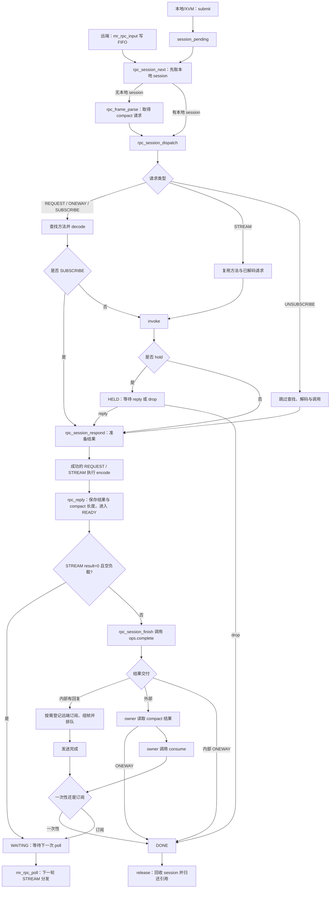
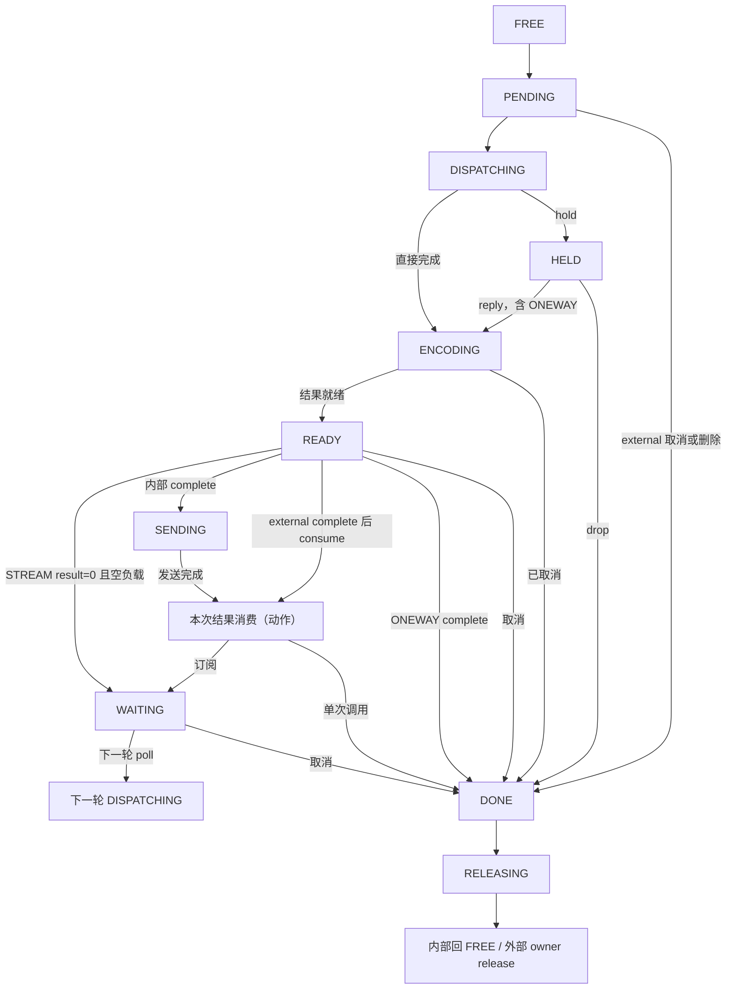

# 远程过程调用（RPC）

> RPC 模块为一个基于帧协议的轻量远程过程调用框架：对端以二进制帧发起请求，本机按
> `service/method` 查表分发到用户方法并回送响应；同时支持单向消息与周期性订阅推送。
> 方法参数与返回值的编解码由 IDL 工具链从 `.idl` 描述文件自动生成。

| 项       | 说明                                                                                                                                                                                                                         |
|----------|------------------------------------------------------------------------------------------------------------------------------------------------------------------------------------------------------------------------------|
| 功能宏   | `MR_USE_MODULE_RPC`（钩子为 `MR_USE_MODULE_RPC_HOOK`）                                                                                                                                                                       |
| 头文件   | `<mrX/modules/rpc/mr_rpc.h>`                                                                                                                                                                                                 |
| 依赖模块 | [FIFO](../../kernel/fifo.md)、[哈希表 Hashmap](../../kernel/hashmap.md)、[软定时器 Timer](../../kernel/timer.md)、[对象系统 Object](../../kernel/object.md)、[内存分配](../../libc/malloc.md)（仅 `mr_rpc_create` 动态方式） |
| 参考测试 | `mrX/test/modules/rpc/rpc.c`                                                                                                                                                                                                 |

---

## 用户指南

### 1. 模块概述

RPC 解决的问题是： **在没有通用网络栈的串行链路（UART、SPI、自定义总线等）上，让 两个设备之间以固定 ID
调用彼此的过程并交换结构化数据**。

特性：

- 二进制帧协议：同步字 + 头部 Fletcher-16 校验 + 可选负载校验和，错误头按同步字重新搜索。
- 六种消息类型：请求、响应、单向、订阅、退订、流推送。
- 方法以 `service ID + method ID` 寻址，链接期自动导出；方法哈希表由 `MR_INIT_LEVEL_MODULE` 的 user-initcall
  建立，因此使用方法分发前必须已经执行 `mr_user_init()`。
- 参数/返回值编解码由 IDL 描述文件生成，`T<N>` 变长数组带元素计数前缀且解码时严格校验上限，越界与截断输入不会破坏内存。文本编码和结尾
  NUL 由应用约定。
- 每个 RPC 对象的会话池与收发工作区预分配，请求处理过程不按调用临时分配内存；只有 `mr_rpc_create`
  的动态对象本身使用堆。支持在方法回调中“持有”会话、稍后再应答。
- 订阅机制：客户端订阅后，服务端按周期自动调用方法并以流帧推送结果。
- 传输层完全由用户注入（`send`/`flush` 两个回调），支持阻塞与部分发送。
- 可选钩子（`MR_USE_MODULE_RPC_HOOK`）：执行器空闲/忙碌事件通知，便于接入线程 调度、低功耗管理或运行期监控。

不适用于：需要请求-响应之外复杂路由的场景（本模块只做一层方法分发）；对端字节序 不同的场景（多字节字段按宿主字节序原样传输，不做转换）。

### 2. 配置与依赖

| 配置项                            | 类型 | 默认值 | 说明                                                                                                     |
|-----------------------------------|------|--------|----------------------------------------------------------------------------------------------------------|
| `MR_USE_MODULE_RPC`               | bool | n      | 启用 RPC 核心（依赖 `MR_USE_MODULE`，自动选择 `MR_USE_TIMER`）                                           |
| `MR_USE_MODULE_RPC_HOOK`          | bool | n      | 启用执行器唤醒/挂起钩子                                                                                  |
| `MR_USE_MODULE_RPC_SELF_DESC`     | bool | n      | 启用 RPC 自描述；把编译后的描述嵌入 ROM，并由生成的 `idl.c` 自动注册自描述方法                           |
| `MR_CFG_RPC_SELF_DESC_CHUNK_SIZE` | 整型 | 128    | 单次自描述请求最大返回字节数，范围 16~1024；增大可减少往返，但可能增大每个 session 的 response 工作区    |
| `MR_CFG_RPC_CALL_BUCKET_NUM`      | 整型 | 16     | 方法哈希表桶数，范围 1~1024；导出方法多时增大，RAM 紧张时减小                                            |
| `MR_CFG_MODULE_RPC_SESSION_NUM`   | 整型 | 1      | 预分配 remote transport 会话数，范围 1~1024；订阅需要额外空闲会话，单会话配置不接受订阅 |
| `MR_CFG_MODULE_RPC_FIFO_SIZE`     | 整型 | 256    | 接收 FIFO 字节数，范围 24~1048576；至少要能容纳 24 字节帧头                                              |

未使用 Kconfig 生成配置头时，`mr_rpc.h` 对 `MR_CFG_MODULE_RPC_SESSION_NUM` 使用回退值 2。

启用后包含头文件即可使用（IDL 生成的 `mr_rpc_idl.h` 会被自动引入）：

```c
#include <mrX/modules/rpc/mr_rpc.h>
```

方法注册表不是在 `mr_rpc_init()` 中建立，而是由模块级 user-initcall 初始化；正常系统启动应先执行 `mr_user_init()`，再开始接收并分发
RPC 帧。

IDL 工具链：方法参数与返回值在 `.idl` 文件中描述，用主仓 CLI 生成头文件与编解码 源文件（默认输出到
`include/mrX/modules/rpc/mr_rpc_idl.h` 与 `modules/rpc/idl.c`， 生成文件不可手动编辑）：

```
python ./scripts/cli.py rpc-idl -i ./test/modules/rpc/rpc.idl --no-cpp
```

IDL 编写、生成与方法实现见下方教程；语法和命令参数见 [RPC IDL 脚本指南](../../scripts/rpc-idl/rpc-idl.md)。

#### RPC 自描述

启用 `MR_USE_MODULE_RPC_SELF_DESC` 后，生成的 `idl.c` 会同时包含二进制描述和完整的 RPC 方法实现：`decode`、`invoke`、
`encode` 以及 `MR_RPC_EXPORT` 都由生成器产生。RPC 核心不包含自描述的特殊发送逻辑，自描述方法使用生成器内部保留的协议 ID
自动注册。关闭选项后，描述 blob、方法代码以及 request/response union 中的自描述工作区都会被裁掉。

接口刻意保持最小：请求 payload 只有一个 `u32 offset`，响应 payload 就是从该偏移开始、最多 `MR_CFG_RPC_SELF_DESC_CHUNK_SIZE`
字节的描述原始分片，不附加额外元数据。`offset` 大于描述长度返回 `-MR_EINVAL`，等于描述长度时成功返回 0 字节 payload。因此
Host 从 offset 0 开始读取，每次用 `offset += response.payload_size` 继续请求，直到收到 0 字节即可获得完整自描述文档。

格式版本和压缩方式属于文档自身，而不是 RPC 读取接口。blob 前 4 字节固定为 `MRID`，随后 1 字节 info：高 4 bit 为格式版本，低 4
bit 为压缩方式（0 = none，1 = zlib）。这 5 字节始终保持未压缩，剩余 body 才根据 info 指示保存为原始或 zlib 数据，因此 Host 从
offset 0 取得首个分片后即可识别文档格式。分片响应本身不重复携带 version、hash、size 等元数据。

二进制描述的具体编码见 [RPC IDL 脚本指南](../../scripts/rpc-idl/rpc-idl.md#运行时二进制描述)。

### 3. 快速上手

以 `lab/ping`（无参数、无返回值的方法）为例，完整链路为：定义传输回调 → 实现方法 入口 → 初始化 → 喂数据并驱动执行器（取材自
`mrX/test/modules/rpc/rpc.c`）：

```c
#include <mrX/modules/rpc/mr_rpc.h>

/* Transport callbacks: return accepted byte count, 0 = busy */
static mr_ssize_t my_send(void *priv, const void *buf, mr_uint32_t size) {
    return uart_write(buf, size);                /* 用户传输层 */
}

static const mr_rpc_ops_t my_ops = {
    .send = my_send,
    .flush = MR_NULL,                            /* 可选 */
};

/* Method entry: service "lab", method "ping" */
MR_RPC(lab, ping) {
    return 0;                                    /* result 写入响应帧 */
}

static mr_rpc_t rpc;

static void rpc_setup(void) {
    mr_rpc_init(&rpc, &my_ops, MR_NULL);
}

static void rpc_poll_once(void) {
    mr_uint8_t buf[64];
    mr_ssize_t size = uart_read(buf, sizeof(buf));

    if (size > 0) {
        mr_rpc_input(&rpc, buf, (mr_uint32_t)size);
    }
    mr_rpc_execute(&rpc);                        /* Parse, dispatch, reply */
    mr_rpc_poll(&rpc);                           /* Drive subscriptions */
}
```

要点：

- `MR_RPC(lab, ping) { ... }` 展开为 IDL 头文件约定名的方法入口函数，链接期由
  `MR_RPC_EXPORT` 自动注册，无需手动建表。
- 收到 `ping` 请求后，本机会自动回送结果码为 `0` 的响应帧。
- RPC 不产生自己的线程：`mr_rpc_input` 只收字节，`mr_rpc_execute` 完成解析、分发 与应答，`mr_rpc_poll`
  驱动订阅推送，三个入口由用户在主循环或线程中调用。
- 带参数的方法（如 `lab/mix`）在入口内直接读写生成类型的 `request`/`response`
  指针，返回非负结果后框架自动打包响应负载。

#### 从 IDL 定义并接入一个计算方法

下面用 `calculator.add` 串起“编写 IDL → 生成代码 → 实现方法 → 驱动收发”。

**1. 编写 `app/rpc/calculator.idl`**

```idl
service calculator @1 {
    add @0 (left: i32, right: i32) -> (sum: i32);
    echo @1 (message: u8<48>) -> (message: u8<48>);
};
```

`-> (sum: i32)` 定义请求-响应方法；不写 `->` 时方法是单向调用。服务 ID 在所有服务中唯一，方法 ID 在同一服务内唯一。两端需使用一致的
ID 和字段定义。完整类型、枚举、结构体、包含文件及语法约束见 [RPC IDL 脚本指南](../../scripts/rpc-idl/rpc-idl.md#idl-语法)。

**2. 生成编解码代码**

从 `mrX/` 目录运行。这里假定上面的文件保存在 `mrX/app/rpc/calculator.idl`：

```text
python ./scripts/cli.py rpc-idl -i ./app/rpc/calculator.idl -o ./app/generated/include/mrX/modules/rpc -c ./app/generated/rpc_idl.c --no-cpp
```

命令会在 `-o` 目录生成固定名称 `mr_rpc_idl.h`，并在 `-c` 指定的位置生成编解码与方法注册源文件。将 `app/generated/include`
放在工程的 include 搜索路径前面，使 `<mrX/modules/rpc/mr_rpc_idl.h>` 找到这份生成头；同时把 `app/generated/rpc_idl.c`
加入工程编译。不要手改生成文件。命令参数和默认输出路径见 [RPC IDL 脚本指南](../../scripts/rpc-idl/rpc-idl.md)。

**3. 实现服务方法**

在应用源文件中包含 RPC 公开头并实现与 IDL 名称一致的入口：

```c
#include <mrX/modules/rpc/mr_rpc.h>
#include <mrX/libc/mr_string.h>

MR_RPC(calculator, add) {
    response->sum = request->left + request->right;
    return 0; /* 结果码；生成编码器会打包 response->sum */
}

MR_RPC(calculator, echo) {
    response->message.size = request->message.size;
    mr_memcpy(response->message.data,
              request->message.data, request->message.size);
    return 0;
}
```

生成头为入口决定 `session`、`request`、`response` 参数；本例三者中有请求与响应，因此入口收到 `request` 并填写 `response`。生成的
`idl.c` 负责解码、调用该入口、编码并注册方法，不需要应用自行维护分发表。非负返回值作为结果码，框架自动发送编码后的响应；负值表示错误响应，负载为空。

**4. 接收并处理对端请求**

沿用前面的 `rpc_setup` 与 `rpc_poll_once` 驱动：传输层收到字节后交给 `mr_rpc_input`，再调用 `mr_rpc_execute`。对端按同一份
IDL 向 service `1`、method `0` 发送 `REQUEST`，本机便会解出 `left` 和 `right`、调用 `calculator.add`，再经 `ops->send` 返回
`sum` 和结果码。例如对端发送 2 和 3，本机返回 `sum = 5`、结果码 `0`；调用 `calculator.echo` 时则会收到原始字节序列。`u8<48>`
字段在 C 中通过 `.size` 与 `.data` 读写，解码器会校验元素个数不超过 48；如果应用把它当文本使用，字符编码和结尾 NUL
由应用自行处理。RPC 模块提供的是请求分发与响应处理端；IDL 生成器不会生成应用侧的远程调用代理，对端需自行按同一协议编码请求。

### 4. 使用说明

**生命周期**

- 静态方式：定义 `mr_rpc_t`，调用 `mr_rpc_init(rpc, ops, priv)`；用完调用 `mr_rpc_del` 归还对象的初始引用。若没有其他引用，清理会同步发生；若仍有
  `mr_rpc_get()` 得到的引用，最终反初始化延后到最后一次 `put`。
- 动态方式：`mr_rpc_create(ops, priv)` 堆分配；`mr_rpc_del` 同样先置 `dying` 并归还初始引用，动态内存只在最后一个对象引用释放时真正回收。
- 仅处理外部 session 时，`ops` 可为 `MR_NULL`；否则 `ops->send` 必须提供，`ops->flush` 可为 `MR_NULL`。
  RPC 只保存 `ops` 与 `priv` 指针，不复制其内容，调用方必须保证它们在最终 release 前持续有效。

**帧协议**

帧由 24 字节头 + 负载 + 可选 2 字节校验尾组成，字段按结构体内存布局紧凑排列：

| 偏移 | 字段           | 类型  | 说明                                                         |
|------|----------------|-------|--------------------------------------------------------------|
| 0    | `header[2]`    | u8[2] | 同步字 `'M'` `'R'`                                           |
| 2    | `version`      | u8    | 发送端固定写 1；当前接收头解析不单独校验该字段              |
| 3    | `type`         | u8    | 消息类型（见下表）                                           |
| 4    | `flags`        | u16   | bit0 = 负载后附 Fletcher-16 校验和                           |
| 6    | `hdr_crc16`    | u16   | 头部 Fletcher-16 校验值（计算时本字段按 0 处理）             |
| 8    | `session`      | u32   | 会话 ID，由发起方分配，响应原样带回                          |
| 12   | `service`      | u16   | 服务 ID                                                      |
| 14   | `method`       | u16   | 方法 ID                                                      |
| 16   | `payload_size` | u32   | 负载字节数                                                   |
| 20   | `value`        | u32   | 双用途：请求侧订阅周期（ms，bit31 = 连续推送），响应侧结果码 |
| 24   | `payload`      | 变长  | IDL 编码负载                                                 |
| 尾部 | `checksum`     | u16   | Fletcher-16（仅 flags bit0 置位时存在）                      |

消息类型：

| 类型                     | 方向 | 说明                                                   |
|--------------------------|------|--------------------------------------------------------|
| `MR_RPC_MSG_REQUEST`     | 请求 | 调用方法并期待响应                                     |
| `MR_RPC_MSG_RESPONSE`    | 响应 | 本机发送器产生；输入时仍会被解析，但不会作为可调用请求执行   |
| `MR_RPC_MSG_ONEWAY`      | 请求 | 调用方法但不回送任何帧                                 |
| `MR_RPC_MSG_SUBSCRIBE`   | 请求 | 订阅：应答后按 `value` 中的周期推送流帧                |
| `MR_RPC_MSG_UNSUBSCRIBE` | 请求 | 按 `session` ID 退订                                   |
| `MR_RPC_MSG_STREAM`      | 推送 | 本机订阅发送器产生；传输层输入在完整帧解析后标记 `-MR_EINVAL` |

**负载编码规则**（由 IDL 生成，对接端实现时需一致）：

- 字段按声明顺序紧凑排列，无填充与对齐。
- `T[N]` 表示恰好 `N` 个元素的定长数组；`T<N>` 表示最多 `N` 个元素的变长数组。变长数组先编码由 `N` 决定宽度的 `u8`/`u16`/
  `u32` 元素计数，再紧跟 `size * sizeof(T)` 字节的有效元素。
- 多字节字段按宿主字节序原样传输。
- 负载总长必须与字段布局完全一致：截断或多余尾部字节都按解码失败处理。

**方法入口约定**

```c
MR_RPC(lab, mix) {
    /* request 指向解码后的请求参数，response 指向待填充的响应结构 */
    response->count = request->count + 1U;
    return 0;                        /* 非负：继续编码并发送响应 */
}
```

- 返回值即响应帧的结果码；返回负数时响应负载为空（错误不携带数据）。
- 返回非负值后框架自动调用生成的编码器打包 `response`；`response` 中变长字段的
  `size` 超限时按 `-MR_EINVAL` 应答。
- 入口内可调用 `mr_rpc_session_hold(session)` 把会话持有到入口之外，稍后用 `mr_rpc_session_reply(session, result)` 应答，或用
  `mr_rpc_session_drop(session)` 放弃（放弃后不发送任何帧）。成功 `mr_rpc_session_reply` 之后不得再访问该会话。内部 remote session
  成功 hold 后由 RPC 保活至 reply/drop 收尾；外部 session 另由 submit 保活至 release。
- 每个会话同一时刻只处理一个请求；会话池耗尽时新帧头不会被消费，等会话释放后 继续处理。

**订阅与退订**

- 客户端发送 `SUBSCRIBE` 帧，`value` 为推送周期（毫秒），bit31（`MR_RPC_SUBSCRIBE_CONTINUOUS`）表示每个 STREAM
  成功发送后不再等待软定时器，而是立即重新进入可 poll 队列；真正再次调用方法仍需要 `mr_rpc_poll()`。周期为 0 返回
  `-MR_EINVAL`。
- 订阅应答成功后，服务端每到周期即重新调用方法入口（`request` 为订阅时的数据，
  `response` 每次重新填充），并以 `STREAM` 帧推送；流帧的结果码为当次方法返回值。
- 当一次 `STREAM` 调用结果为 0 且编码后的语义负载为空时，会话直接重新进入等待，不调用 `complete`，也不发送空流帧。对于只含变长数组的 IDL 响应，所有
  `.size` 都为 0 时按空负载处理，长度前缀本身不会触发结果交付。空 STREAM 即使在连续模式下也等待下一个周期；只有已交付并消费的结果才立即重新进入可 poll 队列。
- 订阅占用一个会话直至退订；订阅还需保留一个空闲会话给普通请求，因此单会话配置 无法订阅。
- 退订发送 `UNSUBSCRIBE` 帧（负载必须为空），按 `session` ID 匹配；无匹配订阅时 应答 `-MR_ENOENT`。

**执行器与钩子**

- RPC 是被动执行模型：数据到达后调用 `mr_rpc_execute`，订阅到期后调用
  `mr_rpc_poll`，两者内部都会尝试发送队列中的响应。
- 传输层"忙"（`send` 返回 0）时帧会保留在发送游标中，稍后调用 `mr_rpc_flush`
  续发，已发送的前缀不会重发。
- 启用 `MR_USE_MODULE_RPC_HOOK` 后可用 `mr_rpc_hook_set` 注册钩子：
  `wakeup` 在执行器从空闲转入忙碌时调用，`suspend` 在从忙碌转回空闲时调用；
  `MR_RPC_EVENT_EXECUTE`（收包执行）与 `MR_RPC_EVENT_POLL`（订阅推送）两个事件 独立上报。推荐用初始值为 0 的信号量作钩子实现睡眠-唤醒调度。

### 5. API 参考

初始化与销毁：

| API             | 说明                                        |
|-----------------|---------------------------------------------|
| `mr_rpc_init`   | 初始化静态 RPC 对象                         |
| `mr_rpc_create` | 堆上创建 RPC 对象                           |
| `mr_rpc_del`    | 删除 RPC 对象（静态反初始化，动态释放内存） |

数据输入与执行：

| API              | 说明                                                 |
|------------------|------------------------------------------------------|
| `mr_rpc_input`   | 向接收 FIFO 写入原始字节（一次性全部写入或全部拒绝） |
| `mr_rpc_execute` | 优先分发本地提交的 session，再处理远端帧         |
| `mr_rpc_flush`   | 发送队列中剩余的响应                                 |
| `mr_rpc_poll`    | 驱动到期的订阅推送                                   |

会话操作：

| API                      | 说明                             |
|--------------------------|----------------------------------|
| `mr_rpc_session_reply`   | 完成持有 session 的回复           |
| `mr_rpc_session_hold`    | 在方法入口内持有会话             |
| `mr_rpc_session_drop`    | 放弃持有的会话（不发送响应）     |
| `mr_rpc_session_init`    | 初始化外部 session              |
| `mr_rpc_submit`          | 提交外部 session 给执行器       |
| `mr_rpc_session_consume` | 消费外部 session 的一次结果            |
| `mr_rpc_session_cancel`  | 取消外部 session                |

方法导出：

| API                       | 说明                                       |
|---------------------------|--------------------------------------------|
| `MR_RPC(service, method)` | 定义 IDL 生成签名的方法入口函数            |
| `MR_RPC_EXPORT(...)`      | 导出自定义编解码的方法（IDL 生成代码使用） |

钩子与引用管理：

| API                         | 说明                                          |
|-----------------------------|-----------------------------------------------|
| `mr_rpc_hook_set`           | 设置执行器钩子（需 `MR_USE_MODULE_RPC_HOOK`） |
| `mr_rpc_get` / `mr_rpc_put` | 引用计数加一 / 减一（对接对象系统）           |

**`mr_rpc_init`**

```c
mr_err_t mr_rpc_init(mr_rpc_t *rpc, const mr_rpc_ops_t *ops, void *priv);
```

- `rpc`：RPC 对象，由调用者分配存储。
- `ops`：传输操作表；仅处理外部 session 时可为 `MR_NULL`，否则 `send` 不可为 `MR_NULL`，`flush` 可为 `MR_NULL`。
- `priv`：用户私有数据，原样传入回调。
- 返回：成功 `0`，失败负数错误码（订阅定时器初始化失败等）。

**`mr_rpc_create`**

```c
mr_rpc_t *mr_rpc_create(const mr_rpc_ops_t *ops, void *priv);
```

堆上分配并初始化 RPC 对象。成功返回对象指针，内存不足或初始化失败返回 `MR_NULL`。

**`mr_rpc_del`**

```c
mr_err_t mr_rpc_del(mr_rpc_t *rpc);
```

调用时先把 `dying` 置真并通过对象系统归还初始引用。订阅定时器删除、队列/接收发送指针清理、`ops/priv` 清空，以及动态对象的
`mr_free` 都属于最终 release 路径：没有额外引用时通常会在本次 `mr_rpc_del` 内同步完成；仍有对象引用时则延后。`dying`
一旦置位，新的 `input/execute/poll` 会拒绝继续工作。每个已接收的 session 持有一份 RPC 引用，直到自身的 `release` 完成；`hold` 沿用这份引用，不再额外获取。删除时会释放仍在队列中的 session 和空闲的接收/发送 session。已持有的 session 仍须最终调用 reply 或 drop，否则删除会一直等待其引用归还。

**`mr_rpc_input`**

```c
mr_ssize_t mr_rpc_input(mr_rpc_t *rpc, const void *data, mr_uint32_t size);
```

- 数据一次性全部写入接收 FIFO 或全部拒绝（不存在半截写入）。
- 返回：成功返回写入字节数；`size` 为 0 时返回 0；FIFO 剩余空间不足返回
  `-MR_EAGAIN`；对象已删除返回 `-MR_ENOENT`；无传输操作表返回 `-MR_ENOSYS`。
- 写入成功即代表有新工作。核心写 FIFO 路径本身不分配内存，但不能把 `mr_rpc_input` 无条件视为 ISR-safe：启用
  `MR_USE_MODULE_RPC_HOOK` 后，首次 EXECUTE 唤醒会在 `mr_rpc_input` 的调用上下文中同步执行用户 `hook->wakeup`；此外还需满足底层
  FIFO 的生产者并发约束。

**`mr_rpc_execute`**

```c
mr_err_t mr_rpc_execute(mr_rpc_t *rpc);
```

先发送之前积压的响应，再循环取本地提交的 session 或远端帧；每处理一条就尝试发送已就绪响应；正常结束或发送暂忙时，批次末才调用传输层 `flush`。本地提交的 session 优先于远端帧。
发送暂忙不会中断本轮分发；收尾阶段会再尝试发送并冲刷。仍未发完则返回 `-MR_EAGAIN`，保留发送游标，稍后可调用 `mr_rpc_flush` 续发。其他发送错误原样返回，dying 返回 `-MR_ENOENT`。发送受阻可能耗尽内部会话池，因此本轮不保证处理完 FIFO 中所有完整帧。
请求负载超过会话缓冲时会完整丢弃该帧，并以 `-MR_ENOMEM` 进入分发；需要应答的请求会回错误帧，`ONEWAY` 不发送响应。

**`mr_rpc_flush`**

```c
mr_err_t mr_rpc_flush(mr_rpc_t *rpc);
```

继续发送上次未完成的帧与队列中的响应，然后调用可选的传输层 `flush`。

**`mr_rpc_poll`**

```c
mr_err_t mr_rpc_poll(mr_rpc_t *rpc);
```

把所有到期（或连续推送）的订阅批量分发给方法入口；remote session 发送流帧，external session 通过 complete 交付结果。没有订阅时调用是安全的空操作。应在主循环中周期调用，或由
`MR_RPC_EVENT_POLL` 钩子 事件触发。

**外部 session 生命周期**

```c
void mr_rpc_session_init(mr_rpc_session_t *session,
                         const mr_rpc_session_ops_t *ops, void *owner);
mr_err_t mr_rpc_submit(mr_rpc_t *rpc, mr_rpc_session_t *session);
mr_err_t mr_rpc_session_consume(mr_rpc_session_t *session);
mr_err_t mr_rpc_session_cancel(mr_rpc_session_t *session);
```

`mr_rpc_session_ops_t` 包含 `complete(session, result, owner)` 和 `release(session, owner)`。同一类 session 共用一份 ops 表，session 保存 ops 指针和 owner 上下文。内部 session 使用 RPC 自己的 ops，由其完成回调组帧并送入发送队列；外部 owner 提供自己的回调。两种 session 都使用生成的 IDL 编解码。`mr_rpc_session_init()` 不清空 `request`，外部 owner 在提交前必须填写 `request.type`（仅接受 `REQUEST`、`ONEWAY`、`SUBSCRIBE`）、`request.service`、`request.method`，将 compact 请求拷贝到 `request.payload` 并填写实际字节数 `recv.size`；订阅还需设置 `request.session` 和 `request.value.subscribe`。提交成功后，RPC 持有一个对象引用，把 session 放入 executor 队列，并在启用 hook 时触发 EXECUTE 唤醒；提交失败时 session 仍归调用方。

每次结果就绪时，RPC 将通用结果写入 `session->response.frame.value.result`，将 compact 响应的实际字节数写入 `session->response.frame.payload_size`，并在锁外调用 `complete`。结果为负数时长度为 0。订阅可多次 complete。同步 owner 可以在回调内复制 compact `response.payload` 并调用 `mr_rpc_session_consume()`；异步 owner 可以等到后续消费时复制，再调用 `consume`。当前结果未消费前，RPC 不会重新调度该订阅或覆盖 response storage。一次性调用消费后进入 `release`；订阅消费后回到等待或 poll 流程。成功的初始 `SUBSCRIBE` 应答也要先消费，才能开始首次 poll。

`mr_rpc_session_cancel()` 终止外部请求或订阅，不再产生新结果；若方法已 hold，取消会等待持有者调用 `mr_rpc_session_reply()` 或 `mr_rpc_session_drop()` 后再 release，不能提前释放 handler 仍持有的 session。`ONEWAY` 处理完成后调用 `complete` 报告结果，不发送帧，回调返回后直接 `release`；drop 放弃结果，只调用 `release`。外部 session 只能在 `release` 回调中释放或复用；同一 session 的 consume/cancel 应由 owner 串行调用，ops 表和 owner 上下文须保持有效直到 release。已交付但未消费的外部结果继续持有 RPC 引用，直到 owner 消费或取消。

**`mr_rpc_session_reply`**

```c
mr_err_t mr_rpc_session_reply(mr_rpc_session_t *session, mr_err_t result);
```

- 接受 `REQUEST`、`STREAM` 与 `ONEWAY` 类型的会话，其他类型返回 `-MR_EPERM`。
- `REQUEST`/`STREAM` 在 `result` 非负时由 IDL 编码 compact 响应，负数时产生空负载错误结果；内部 session 的完成回调组帧并发送，外部 session 通过 owner 的 `complete` 交付 compact 响应。
- `ONEWAY` 不编码或发送响应帧，直接以 `result` 调用 `complete`，回调返回后调用 `release`。
- 同一会话重复 `reply` 返回 `-MR_EPERM`。
- 成功返回后不得再访问该会话；session 持有的 RPC 引用在最终 release 后归还。

**`mr_rpc_session_hold` / `mr_rpc_session_drop`**

```c
mr_err_t mr_rpc_session_hold(mr_rpc_session_t *session);
mr_err_t mr_rpc_session_drop(mr_rpc_session_t *session);
```

`hold` 只能在方法入口（分发回调）内调用，把会话从“分发中”迁到“持有”状态，否则返回 `-MR_EPERM`；RPC 已进入删除阶段时返回 `-MR_ENOENT`。持有期间该 session 不会被分配给新请求。
`drop` 把持有的会话直接 release，不发送任何帧；未持有状态调用返回 `-MR_EPERM`。`hold` 沿用 session 已持有的 RPC 引用，reply/drop 收尾并最终 release 后归还。

**`MR_RPC(service, method)`**

```c
MR_RPC(lab, ping) {
    /* session / request / response 由生成签名决定 */
}
```

展开为 IDL 头文件约定的入口函数名。生成器为每个方法产出签名：有响应段的方法为
`(session, request, response)`；无响应段的方法为 `(session, request)`； 无请求无响应的方法为 `(session)`。入口返回
`mr_err_t` 结果码。

**`mr_rpc_hook_set`**

```c
mr_err_t mr_rpc_hook_set(mr_rpc_t *rpc, const mr_rpc_hook_t *hook);
```

`hook` 的 `wakeup`/`suspend` 原型为 `void (*)(mr_rpc_t *rpc, mr_rpc_event_t event, void *param)`，`param` 取注册时提供的
`hook->param`。RPC 只保存 `hook` 指针，调用方必须保证该结构持续有效；`mr_rpc_hook_set` 本身也没有并发更新保护。内部
`depth[]` 用于抑制重复 wakeup，并在对应 executor 结束时触发 suspend，它不是可供外部读取的精确队列长度。

**`mr_rpc_get` / `mr_rpc_put`**

```c
mr_rpc_t *mr_rpc_get(mr_rpc_t *rpc);
mr_bool_t mr_rpc_put(mr_rpc_t *rpc);
```

跨上下文持有 RPC 指针时先 `get` 后 `put`；引用归零即到达生命周期终点。一般应用 代码不需要使用。

### 6. 完整示例

示例 1：带参数方法的往返——`lab/mix` 演示请求解码、响应填充与结果码（改编自
`mrX/test/modules/rpc/rpc.c` 的 `valid_idl_roundtrip`）：

```c
MR_RPC(lab, mix) {
    /* request: title(u8<16>) count(u32) note(u8<32>) blob(u8<40>) */
    response->title.size = 2U;
    mr_memcpy(response->title.data, "ok", 2U);
    response->count = request->count + 1U;
    return 7;                        /* Peer reads result 7 in response frame */
}
```

对端以 `service = 1`（`lab`）、`method = 0`（`mix`）发起 `REQUEST` 帧，收到
`result = 7` 的 `RESPONSE` 帧，负载为编码后的响应字段。

示例 2：持有会话、延迟应答——方法入口内无法立即完成时（改编自
`session_hold_reply_drop_and_pool`）：

```c
static mr_rpc_session_t *pending;
static mr_rpc_t *pending_rpc;

MR_RPC(lab, ping) {
    mr_err_t ret = mr_rpc_session_hold(session);
    if (ret != 0) {
        return ret;
    }
    pending_rpc = mr_rpc_get(session->rpc);  /* Extra reference for later flush */
    pending = session;
    return 0;
}

/* Later, from another context: */
void complete_pending(void) {
    mr_rpc_session_reply(pending, 77);       /* Consumes the held reply opportunity */
    mr_rpc_flush(pending_rpc);               /* Drive the transport */
    mr_rpc_put(pending_rpc);
    pending = MR_NULL;
    pending_rpc = MR_NULL;
}
```

示例 3：订阅推送——客户端订阅后服务端周期推送：

```c
MR_RPC(lab, table) {
    response->rows[0] = request->rows[0];    /* Echo last subscribed rows */
    response->rows[1] = request->rows[1];
    return 9;
}

/* Main loop: poll drives due subscriptions and sends STREAM frames */
for (;;) {
    transport_pump();
    mr_rpc_execute(&rpc);
    mr_rpc_poll(&rpc);
    idle();
}
```

更多行为参考（错误矩阵、流重同步、超限负载、删除竞态）见
`mrX/test/modules/rpc/rpc.c`。

### 7. 常见问题（FAQ）

**Q：`mr_rpc_input` 返回 `-MR_EAGAIN`？**

接收 FIFO 剩余空间不足本次写入，数据被整体拒绝。分小块喂数据，或增大
`MR_CFG_MODULE_RPC_FIFO_SIZE`（至少 24 字节，能容纳一个帧头）。

**Q：明明收到了请求，对端却收不到响应？**

检查执行链路：`mr_rpc_input` 之后必须调用 `mr_rpc_execute`；传输层 `send` 返回 0 表示忙，帧会停在发送游标，需要稍后调用
`mr_rpc_flush` 续发。已发送的字节不会重发，
`send` 只需接受剩余部分。

**Q：方法收到 `-MR_ENOSYS` 应答？**

`service + method` 没有注册：确认 `.idl` 中定义了该方法并用 `cli.py rpc-idl` 重新生成 （生成代码与 schema 不同步是最常见原因）；同时确认
`MR_USE_MODULE_RPC` 已启用， 初始化调用序列在首帧之前已执行。

**Q：订阅请求被拒绝？**

三种情况：周期为 0 或非法返回 `-MR_EINVAL`；`session` ID 重复订阅返回
`-MR_EEXIST`；无空闲订阅槽位或没有多余空闲会话返回 `-MR_ENOMEM`——把
`MR_CFG_MODULE_RPC_SESSION_NUM` 增到至少 2。

**Q：订阅了但没有周期性流帧？**

确认主循环（或 `MR_RPC_EVENT_POLL` 钩子触发的调度）在调用 `mr_rpc_poll`；订阅 推送由本机软定时器到期后进入就绪列表，
`mr_rpc_poll` 负责真正的分发与发送。

**Q：响应负载内容对不上？**

确认两端由同一份 `.idl` 生成：字段顺序、变长长度前缀（1 字节）、总长严格一致。 解码器对截断与多余尾部字节都返回 `-MR_EINVAL`
，可据此定位。

**Q：入口返回后还能继续用 `response` 吗？**

不能。返回非负值后框架立即编码 `response` 并入队，会话可能已被回收。需要延迟 应答时使用 `hold`/`reply`/`drop` 流程。

**Q：钩子回调里能做什么？**

`wakeup`/`suspend` 只用于调度通知（如释放/获取信号量），不要在回调中直接调用
`mr_rpc_execute` 等重入本模块。

---

## 开发者指南

### 8. 架构总览

RPC 由方法表（链接期段 + 哈希表）、内部会话池、外部待执行队列、接收解析、统一分发与完成、发送队列和订阅定时器组成，全部运行于调用者上下文：

```
        +--------------------------------------------------+
        |  应用 / 主循环（或 hook 驱动的线程）                |
        +----+-------------------+---------------------+---+
             | mr_rpc_input      | mr_rpc_execute      | mr_rpc_poll
             v                   v                     v
        +----------+   +---------------------+   +-------------+
        | 接收FIFO  |-->| 接收状态机 + 分发器   |   | 订阅定时器    |
        | (fifo)   |   | decode->invoke->encode|  | (soft timer) |
        +----------+   +----------+----------+   +------+------+
                                | 发送就绪队列           | 到期会话
                                v                      v
                        +---------------------+   mr_rpc_poll
                        | 发送器 send_execute   |<------+
                        | (ops->send / flush)  |
                        +---------------------+
             方法查找：mr_rpc 段 -> hashmap（service<<16|method）
             依赖：对象系统（生命周期/引用）、自旋锁（队列与会话池）、
                   原子操作（dying/发送器互斥）、malloc（仅动态创建）
```

- 方法入口 `MR_RPC(_service, _method)` 展开的函数由生成代码（idl.c）内的
  `MR_RPC_EXPORT` 放入 `mr_rpc.<level>` 链接段（start `"0.end"`、end
  `"8.end"` 哨兵夹持），`rpc_module_init` 在 `MR_INIT_LEVEL_MODULE` 级别遍历该段建立哈希表。
- 生成代码（idl.c）承担每个方法的解包（unpack）、入口转调（invoke）与打包（pack）， 核心协议层只面对不透明的负载缓冲。
- 外部 session 经 `session_pending` 进入 `mr_rpc_execute`，优先于 FIFO 中的远端帧；两者共用方法查找、IDL 编解码与调用，外部 session 通过 owner 的 `complete`/`release` 回调交付和回收。

### 9. 数据结构

RPC 对象（`mrX/include/mrX/modules/rpc/mr_rpc.h`）：

| 字段               | 说明                                                                                      |
|--------------------|-------------------------------------------------------------------------------------------|
| `parent`           | 对象基类，静态/动态双 clazz 决定 `mr_rpc_del` 收尾方式                                 |
| `dying`            | 原子删除标记；`input`/`execute`/`poll` 入口与各完成路径检查它提前退出                     |
| `hook` / `depth[]` | 钩子表与每事件深度计数（`MR_USE_MODULE_RPC_HOOK`）                                        |
| `sessions[]`       | 预分配 `mr_rpc_session_t` 远端会话池，`MR_CFG_MODULE_RPC_SESSION_NUM` 个                 |
| `session_pending`  | 已提交、等待执行的外部 session 队列                                                       |
| `session_free`     | 空闲会话链表                                                                              |
| `recv`             | 接收单元：FIFO、解析状态、正在接收的会话                                                  |
| `send`             | 发送单元：就绪队列、当前发送会话、`running` 原子互斥                                      |
| `subs`             | 订阅单元：会话指针槽位数组、软定时器、到期链表 `tlist`、就绪链表 `list`                   |
| `ops` / `priv`     | 传输回调与私有数据                                                                        |

核心会话（`mr_rpc_session_t`）保存统一 RPC 生命周期、IDL 工作区、接收/发送游标、`deadline`（订阅到期 tick）、`dispatching`（回调正在运行的标志）、`state`（十态状态机）和 `action`（普通调用、订阅轮询或取消）。每个活动 session 持有一份 RPC 引用；`PENDING` 同时表示远端帧正在接收或本地 session 已提交待分发。

关键编码约定：

- 调用 ID 为 `(service << 16) | method`，哈希表键即此值。
- 订阅周期最高位 bit31 为连续推送标志，参与周期计算前被掩掉。
- 会话状态 `state` 由全局自旋锁 `__rpc_lock` 保护；用户回调运行期间以 `dispatching = MR_TRUE`
  阻止并发回收。

IDL 生成头（`mrX/include/mrX/modules/rpc/mr_rpc_idl.h`，由工具链生成）提供定长 string/bytes 类型（`u8` 长度前缀 +
固定容量数据）、请求/响应联合
`mr_rpc_idl_request_t`/`mr_rpc_idl_response_t`（会话缓冲按联合最大成员定容）、 每个方法的入口签名宏（`__MR_RPC_ENTRY_*`）。

### 10. 核心流程

**模块初始化**：`rpc_module_init` 通过 `MR_INIT_EXPORT(..., MR_INIT_LEVEL_MODULE)` 注册为 user-initcall；执行
`mr_user_init()` 时它断言 start/end 哨兵顺序合法，初始化 `__rpc_call_table` 哈希表，遍历 `mr_rpc_call` 段内每个导出项，断言三个回调非空后以
`RPC_CALL_ID` 为键插入（重复注册由断言拦截）。`mr_rpc_init()` 只初始化某个 RPC 实例，不会替代这一步全局方法表初始化。每个 RPC
对象初始化时（`rpc_init`）依次初始化会话池、接收 FIFO、发送队列、钩子与订阅定时器，最后初始化对象；对象初始化失败会回滚定时器。

**整体处理流程**（本地待执行 session 优先于远端 FIFO；两种来源共用 IDL 编解码与分发）：



查找与 `decode` 只在首次 `REQUEST`、`ONEWAY` 或 `SUBSCRIBE` 中执行；`SUBSCRIBE` 首次应答不调用方法，后续 `STREAM` 才调用。`UNSUBSCRIBE` 在结果准备阶段按远端 session ID 取消订阅。错误结果跳过响应编码；`drop` 和未执行就取消的 session 只走 release，不调用 complete。

**Session 状态流转**（从上到下；订阅的下一轮 poll 在图中展开，不画回环）：



`PENDING` 对 remote session 表示正在接收帧，对 external session 表示已提交待执行。
本地 session 从待执行队列摘下时先进入 `DISPATCHING`，使取消等待分发收尾；
`dispatching` 标志在共同的分发入口置位，表示回调仍在使用 session。
`complete` 只交付本次结果；发送完成或 owner 消费结果后，订阅才回到 `WAITING`。
`drop` 和未产生结果的取消直接进入释放流程。

**接收状态机**（`rpc_frame_parse`）：单次 `mr_rpc_execute` 内循环推进 直到无进展：

1. `SYNC`：从 FIFO 顶部窥探 24 字节头（`rpc_frame_header_parse`）。同步字不匹配滑过 1 字节；头部
   CRC 错误滑过 2 字节；当前此阶段不校验 `version`/`type`。通过同步字和头部 CRC 后需要从空闲池取得会话（`rpc_session_acquire`），
   池空时暂停解析等待会话释放。
2. `PAYLOAD`：按 `payload_size` 读取负载；超限（大于 `sizeof(mr_rpc_idl_request_t)`） 转入 `DISCARD`，只丢弃不进用户入口。
3. `CHECKSUM`：窥探并消费 2 字节 Fletcher-16 尾；不匹配报 `-MR_EINVAL`，超限负载报 `-MR_ENOMEM`。
4. 负载或丢弃完成后由 `rpc_frame_complete` 脱离接收 session；校验成功的传输层 `STREAM` 在此标记 `-MR_EINVAL`，随后返回会话进入分发。

**分发**：会话进入 `DISPATCHING` 后按调用 ID 查找方法，并用生成的 `decode` 解开 compact request；`UNSUBSCRIBE`
和由订阅 session 内部转换出的 `STREAM` 轮询不重复查找或解码。传输层输入的 `STREAM` 已带 `-MR_EINVAL`，不会进入 `invoke`。两类合法调用会话共用取消检查与 `invoke`。
随后 `rpc_session_respond` 取得回复存储，`rpc_result_prepare` 校验订阅周期或调用生成的 `encode` 打包普通结果；远端退订从 session ID 槽位取消订阅。`rpc_reply` 保存结果和 compact 长度；`rpc_session_finish` 先统一吞掉 result=0 且无负载的 STREAM，再调用 owner 的 `complete`。内部完成回调登记远端订阅、组帧与发送；外部完成回调交付 compact 结果。

**应答与发送**：内部 `rpc_session_complete` 在 session 的 `response.frame` 中构造帧头（头部字段回填远端 ID/flags，头部 Fletcher-16 在校验字段清零后计算）。发送器按 frame → response payload → checksum 三段推进发送游标；`send.running` 原子交换保证单执行者，执行器逐条发送响应并在本轮结束后调用 `ops->flush` 冲刷传输层。回调在自旋锁外执行；`send` 返回 0（忙）时保留游标，返回 `-MR_EAGAIN`。
remote 会话发送完成与外部 owner 消费结果后，使用同一状态迁移：一次性请求释放，订阅转入
`WAITING`；连续模式进入就绪链表等待 `mr_rpc_poll`。

**订阅定时**（`rpc_subs_timer_entry`）：软定时器到期后把 deadline 已到 的会话从 `tlist` 搬到就绪 `list`，按最近
deadline 重设周期并触发 `POLL` 唤醒； 无到期项时停表。插入按 deadline 有序（`rpc_subs_rearm`），比较使用
回绕安全的半区间判断（`(a - b) >= MR_TICK_MAX / 2`）。

**删除**：公开 `mr_rpc_del` 先置 `dying`，释放待执行、待轮询和待发送队列中的 session，再结束空闲的接收/发送 session，最后调用 `mr_object_del`；真正的 `rpc_del` 清理函数由对象最终 release 调用。正在运行的回调通过 `dispatching` 与完成路径的 `dying` 检查收尾。每个已接收的 session 持有一份 RPC 引用，最终 release 后归还；held session 若始终不 reply/drop，RPC 的最终清理也会一直等待。

### 11. 并发与中断安全

- 全局自旋锁 `__rpc_lock` 保护：会话空闲池、订阅槽位与两条订阅链表、发送就绪队列、
  接收/发送会话指针的迁移。锁临界区都很短，用户回调（decode/invoke/encode）与 编码均不在锁内执行。
- 模块不切换执行上下文。`mr_rpc_input` 可能同步触发 EXECUTE `hook->wakeup`；订阅 timer 回调也可能同步触发 POLL
  `hook->wakeup`。因此 ISR 可用性取决于调用环境、FIFO 使用方式以及用户 hook，不能由 RPC 核心统一保证。
- `mr_rpc_execute`/`mr_rpc_poll` 会进入 IDL decode/invoke/encode 与 `ops->send/flush`，`mr_rpc_flush` 也会直接调用
  transport 回调；这些回调是否可阻塞、是否可在中断上下文执行由应用与平台决定，通常应在受控的服务上下文中串行驱动。
- 帧解析状态（`recv.state`、接收中的会话）不受独立执行锁保护：`execute` 的解析阶段不可重入。发送端只有 `send.running`
  保证单发送执行者，不能替整个 RPC 对象提供全局串行化；应用应保证同一 RPC 的 execute 控制流不并发交错。
- `dying` 用于让后续工作尽快退出，但对象内存与最终资源清理仍依赖引用计数。若其他上下文仍持有 RPC 指针，应先通过
  `mr_rpc_get` 建立有效引用，不能只依赖 `dying` 解决 use-after-free。
- 订阅定时器回调先 `mr_rpc_get` 持有引用再操作，删除后的定时器触发会自动摘除自身。

### 12. 扩展与派生

**新增方法（推荐路径：IDL）**

1. 在 `.idl` 中声明类型与服务（参考 `mrX/test/modules/rpc/rpc.idl` 的
   `enum`/`struct`/`service` 语法；方法缺省响应段即生成无 `response` 的入口签名）。
2. 执行 `python ./scripts/cli.py rpc-idl -i <schema>.idl --no-cpp`，生成
   `mr_rpc_idl.h`（含请求/响应类型、入口签名宏）与 `idl.c`（含 unpack/pack 编解码与 `MR_RPC_EXPORT` 注册）。
3. 在应用中用 `MR_RPC(service, method) { ... }` 实现入口并返回结果码。

**手写编解码**：不用 IDL 时可对任意 `service/method` 手写三个回调并用
`MR_RPC_EXPORT(name, decode, invoke, encode, service_id, method_id)` 导出（三个回调 都必须非空，模块初始化时由断言检查）。
`decode` 负责把 `session->request.payload`
的原始负载转换并校验（`session->recv.size` 为 compact 实际长度），`invoke` 执行业务逻辑，
`encode` 打包 `session->response.payload` 并返回负载字节数（负数视为错误）。生成 代码即按此约定实现，可作为模板（
`mrX/modules/rpc/idl.c:103`）。

**传输层适配**：实现 `mr_rpc_ops_t` 即可接入任意链路；`send` 返回实际接受字节数 （0 表示忙，负数表示错误），支持任意粒度的部分发送；
`flush` 用于驱动带缓冲的 传输硬件，可为 `MR_NULL`。

### 13. 源码导读

| 文件 | 关键函数 | 职责 |
|------|----------|------|
| `mrX/include/mrX/modules/rpc/mr_rpc.h` | — | 帧格式、会话类型、公开 API 与导出宏 |
| `mrX/include/mrX/modules/rpc/mr_rpc_idl.h` | — | IDL 生成的请求/响应类型与入口签名 |
| `mrX/modules/rpc/rpc.c` | `rpc_init` | 会话池、接收/发送单元、钩子与订阅定时器初始化 |
| 同上 | `rpc_frame_parse`、`rpc_session_next` | 帧解析与待执行 session 选择 |
| 同上 | `rpc_subs_add`、`rpc_subs_cancel` | 订阅登记与取消 |
| 同上 | `rpc_session_finish` | 结果通知、订阅重调度与最终释放 |
| 同上 | `rpc_session_respond`、`rpc_reply` | 类型处理、编码与应答准备 |
| 同上 | `rpc_session_dispatch` | 方法查找、解码、调用与自动应答 |
| 同上 | `rpc_send_execute` | 单执行者发送、部分发送与冲刷 |
| 同上 | `mr_rpc_execute`、`mr_rpc_poll` | 请求与订阅的执行入口 |
| 同上 | `rpc_session_complete`、`rpc_session_release` | 内部 session 入发送队列与归还池 |
| 同上 | `rpc_del`、`rpc_module_init` | 对象清理与方法表注册 |
| `mrX/modules/rpc/idl.c` | — | IDL 生成编解码源（勿手改） |
| `mrX/test/modules/rpc/rpc.c` | — | RPC 行为测试 |
| `mrX/test/modules/rpc/rpc.idl` | — | 测试用 IDL schema |

### 14. 附录

**配置宏**

| 宏                              | 说明                                                        |
|---------------------------------|-------------------------------------------------------------|
| `MR_USE_MODULE_RPC`             | 模块开关，默认 n，依赖 `MR_USE_MODULE`，选择 `MR_USE_TIMER` |
| `MR_USE_MODULE_RPC_HOOK`        | 执行器唤醒/挂起钩子开关，默认 n                             |
| `MR_CFG_RPC_CALL_BUCKET_NUM`    | 方法哈希表桶数，默认 16，范围 1~1024                        |
| `MR_CFG_MODULE_RPC_SESSION_NUM` | 预分配会话数，Kconfig 默认 1、头文件回退值 2，范围 1~1024      |
| `MR_CFG_MODULE_RPC_FIFO_SIZE`   | 接收 FIFO 字节数，默认 256，范围 24~1048576                 |
| `MR_RPC_FRAME_FLAG_CHECKSUM`    | flags bit0：负载后附 Fletcher-16 校验和                     |
| `MR_RPC_SUBSCRIBE_CONTINUOUS`   | 订阅周期 bit31：流帧发送后立即连续推送                      |

**消息类型与会话状态**

| 名称                                                                                            | 说明                          |
|-------------------------------------------------------------------------------------------------|-------------------------------|
| `MR_RPC_MSG_REQUEST/RESPONSE/ONEWAY/SUBSCRIBE/UNSUBSCRIBE/STREAM`                               | 六种消息类型                  |
| `MR_RPC_SESSION_STATE_*`（FREE/PENDING/DISPATCHING/HELD/ENCODING/WAITING/READY/SENDING/DONE/RELEASING） | 会话状态机（开发者视图）      |
| `MR_RPC_EVENT_EXECUTE/POLL`                                                                     | 钩子事件（收包执行/订阅推送） |

**错误码**：本模块 API 失败返回负数错误码（见
`mrX/include/mrX/libc/mr_errno.h`），常见：

| 错误码       | 场景                                                                           |
|--------------|--------------------------------------------------------------------------------|
| `-MR_EAGAIN` | 接收 FIFO 空间不足；传输层忙（`send` 返回 0）                                  |
| `-MR_EINVAL` | 传输层输入 STREAM、负载解码失败、校验和不匹配、订阅周期为 0、退订携带负载、外部 session 状态/请求非法 |
| `-MR_ENOMEM` | 请求负载超过会话缓冲（丢弃并应答）；订阅无空闲槽位/会话                        |
| `-MR_ENOENT` | RPC 已进入 dying；退订的会话 ID 不存在；保活引用获取失败等                     |
| `-MR_EEXIST` | 同一会话 ID 重复订阅                                                           |
| `-MR_ENOSYS` | service/method 未注册；local-only RPC 调用 `mr_rpc_input`                      |
| `-MR_EPERM`  | 在错误状态下 `reply`/`hold`/`drop`/`consume`；`reply` 用于不支持的 session 类型 |
| `-MR_EIO`    | 传输层 `send` 返回超过剩余长度的字节数                                         |

参数非法（空指针、对象未初始化、类型不匹配）在断言开启时由 `MR_ASSERT` 拦截。 负数结果码同时出现在响应帧的 `value` 字段中，对端按同样的
`mr_errno` 语义解读。
