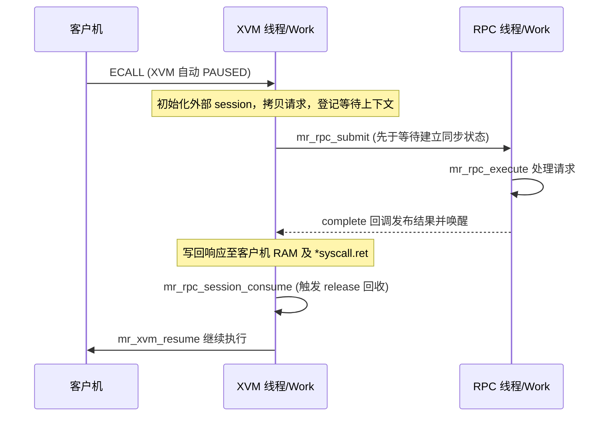

# 虚拟机（XVM）

指令步进调度的可扩展虚拟机框架：宿主通过 `mr_xvm_execute()`
按步数预算驱动客户机执行，客户机通过系统调用和异常事件与宿主交互，指令集架构（ISA）以运行期注册方式插拔。内置
`"riscv32"` 后端提供 RV32IM 指令集、机器模式 CSR/trap 与外部中断注入。

| 项目   | 说明                                                                                                                 |
|--------|----------------------------------------------------------------------------------------------------------------------|
| 功能宏 | `MR_USE_MODULE_XVM`（内置后端 `MR_USE_MODULE_XVM_RISCV32`）                                                          |
| 头文件 | `<mrX/modules/xvm/mr_xvm.h>`（自动引入 `mr_xvm_isa.h`，调试开启时引入 `mr_xvm_debug.h`）                             |
| 依赖   | [对象系统](../../kernel/object.md)、[内存分配](../../libc/malloc.md)（仅 `mr_xvm_create`）、[调试器](dbg.md)（可选） |
| 测试   | `test/modules/xvm/xvm.c`                                                                                             |
| 工具链 | [xvm-isa-riscv32](https://gitee.com/MacRsh/xvm-isa-riscv32)（RISC-V32 客户机固件模板与配套 GCC 工具链）              |

## 配置

| 配置项                         | 类型 | 默认值 | 说明                                                 |
|--------------------------------|------|--------|------------------------------------------------------|
| `MR_USE_MODULE_XVM`            | bool | n      | 启用 XVM 核心                                        |
| `MR_CFG_XVM_SYSCALL_PARAM_NUM` | int  | 7      | 系统调用事件的参数指针槽数，范围 1~64                |
| `MR_USE_MODULE_XVM_RISCV32`    | bool | n      | 启用 RISCV32（RV32IM）ISA 后端，注册名为 `"riscv32"` |

## 快速上手

内置 `"riscv32"` 通过 `MR_INIT_LEVEL_MODULE` 级别的 user-initcall 注册，启动后须先执行
`mr_user_init()` 再初始化虚拟机：

```c
#include <mrX/modules/xvm/mr_xvm.h>

void run_guest(void) {
    mr_uint8_t data[512];
    /* ADDI a7, x0, 1; ECALL */
    static const mr_uint8_t image[8] = {
        0x93, 0x08, 0x10, 0x00,
        0x73, 0x00, 0x00, 0x00,
    };
    mr_xvm_t xvm;
    mr_xvm_event_t event = {0};

    if (mr_xvm_init(&xvm, "riscv32", data, sizeof(data)) != 0) {
        return;
    }
    /* entry >= image_size：RISCV32 将 entry 作为客户机 RAM 基址，PC 初始为 0 */
    if (mr_xvm_load(&xvm, image, sizeof(image), 0x100) != 0) {
        mr_xvm_del(&xvm);
        return;
    }

    for (;;) {
        mr_xvm_return_t er = mr_xvm_execute(&xvm, &event, 100);
        if (er == MR_XVM_SYSCALL) {
            /* event.syscall.nr 取自 A7，param[0..6] 取自 A0~A6 */
            *event.syscall.ret = 0;
            mr_xvm_resume(&xvm);
            continue;
        }
        break; /* MR_XVM_NONE / MR_XVM_EXCEPT / MR_XVM_EXIT */
    }
    mr_xvm_del(&xvm);
}
```

## 核心机制与约束

### 状态机与执行返回

| 状态                    | 进入条件                              | 离开方式                              |
|-------------------------|---------------------------------------|---------------------------------------|
| `MR_XVM_STATUS_INIT`    | `mr_xvm_init` / `mr_xvm_create` 完成  | `mr_xvm_load` 成功                    |
| `MR_XVM_STATUS_RUNNING` | `load` 成功、`resume` 成功            | `execute` 返回非 `NONE`、`pause`      |
| `MR_XVM_STATUS_PAUSED`  | `mr_xvm_pause`、`MR_XVM_SYSCALL`      | `mr_xvm_resume`                       |
| `MR_XVM_STATUS_EXCEPT`  | 未被调试 probe 隐藏的 `MR_XVM_EXCEPT` | `mr_xvm_resume`（清除异常并恢复运行） |
| `MR_XVM_STATUS_ENDED`   | `execute` 返回 `MR_XVM_EXIT`          | 仅可重新 `mr_xvm_load` 复位           |

- **步进预算**：`mr_xvm_execute(xvm, event, step)` 中的 `step`
  是本次执行循环预算而非严格退休指令数（外部中断与客户机 trap 入口也会消耗预算）。非
  `RUNNING` 状态调用会立即返回 `MR_XVM_NONE` 且 `event->none.step = 0`。
- **系统调用**：`ECALL` 触发 `MR_XVM_SYSCALL` 并暂停虚拟机。RISCV32 约定 `A7`
  为调用号（0 号约定为退出，直接返回 `MR_XVM_EXIT`），`A0~A6` 对应 `param[0..6]`
  ；宿主写回 `*event.syscall.ret` 并 `resume` 后，下次 `execute` 开头会将该值写回
  `A0`。
- **异常与中断**：RISCV32 对多数取指/执行异常先尝试进入客户机 `mtvec`
  trap，无有效向量时上报 `MR_XVM_EXCEPT`（`BREAK` 直接上报不进
  trap）。启用 [调试器](dbg.md) probe 后，所有 `MR_XVM_EXCEPT` 都会被调试层拦截并改写为
  `MR_XVM_NONE`。`MR_XVM_EXCEPT_NR_DIV0` 预留给除零陷入的 ISA（RISCV32 除零不触发异常）。

### 内存布局与安全性边界

- **镜像与 RAM 分离**：`image` 仅保存宿主指针而不拷贝，须在运行期保持有效；RISCV32
  将 `[0, image_size)` 映射为只读（`mr_xvm_datamem_store()` 返回 `-MR_EPERM`），
  `data` 缓冲开头的 `sizeof(core_t)` 字节用作 CPU/CSR 影子状态，剩余部分从
  `entry` 开始映射为可写 RAM。`mr_xvm_load()` 断言 `entry >= image_size` 以防止区域重叠。
- **跨区访问**：`mr_xvm_datamem_load()` / `store()` / `map()`
  遇到跨区边界时会截断到当前映射区末尾，调用方需按返回字节数分段推进。
- **安全定位**：XVM 限制客户机只能访问显式映射区域，但当前实现未声明为面向恶意代码的安全沙箱，不可仅凭此层假定任意不可信输入均具备强隔离边界。

### 异步处理 Syscall（与 RPC 协同）

当 XVM 与 [RPC](../rpc/rpc.md) 运行在不同工作线程或 workqueue 中时，可通过外部
RPC session 异步处理需要等待响应的系统调用：



- **时序契约**：`mr_rpc_submit()` 返回前 `complete` 可能已经触发，须先保存上下文与等待状态再提交；禁止在
  XVM work 内阻塞等待，应在收到通知后重新调度写回与 `mr_xvm_resume()`；
  `event.syscall` 内的指针在本次调用结束前不可重载镜像或删除 XVM。

### 并发与生命周期约束

- **单执行者锁**：`flags` bit0（`MR_XVM_FLAG_LOCK`）通过 CAS 串行化 `mr_xvm_load()`
  与 `mr_xvm_execute()`（并发 `load` 返回 `-MR_EBUSY`，并发 `execute` 返回
  `step=0` 的 `MR_XVM_NONE`）。该锁 **不保护** `reg_*`、`datamem_*`、`interrupt`
  或调试接口，调用这些接口时应确保目标已暂停或由外部串行化。
- **对象保活**：`execute`/`load` 内部不自动调用 `mr_xvm_get()`；跨上下文使用时若可能并发调用
  `mr_xvm_del()`，须先 `get` 再操作，用完 `put`。

## API 速查

| 分组        | API                                           | 说明                                                       |
|-------------|-----------------------------------------------|------------------------------------------------------------|
| 生命周期    | `mr_xvm_init(xvm, isa_name, data, data_size)` | 初始化静态虚拟机并绑定 ISA（找不到 ISA 返回 `-MR_ENOENT`） |
| 生命周期    | `mr_xvm_create(isa_name, data_size)`          | 在堆上一次性分配对象与 RAM                                 |
| 生命周期    | `mr_xvm_del(xvm)`                             | 置 `DYING` 标记并归还初始引用                              |
| 生命周期    | `mr_xvm_get(xvm)` / `mr_xvm_put(xvm)`         | 增加 / 释放对象引用计数                                    |
| 执行控制    | `mr_xvm_load(xvm, image, image_size, entry)`  | 清零 RAM、复位 ISA、清空断点并置 `RUNNING`                 |
| 执行控制    | `mr_xvm_execute(xvm, event, step)`            | 执行最多 `step` 预算，返回停机类型并填充 `event`           |
| 执行控制    | `mr_xvm_pause(xvm)` / `mr_xvm_resume(xvm)`    | `RUNNING` → `PAUSED` / `PAUSED` 或 `EXCEPT` → `RUNNING`    |
| 执行控制    | `mr_xvm_status(xvm)`                          | 原子读取当前虚拟机状态                                     |
| 执行控制    | `mr_xvm_interrupt(xvm, irq, active)`          | 断言或撤销外部中断（RISCV32 支持 `irq` 0~31）              |
| 寄存器/内存 | `mr_xvm_reg_load(xvm, nr, val)` / `reg_store` | 读写寄存器（RISCV32：0~31 为 `x0~x31`，32 为 `PC`）        |
| 寄存器/内存 | `mr_xvm_datamem_load` / `store` / `map`       | 按客户机地址读写或直接映射宿主指针                         |
| 宏          | `MR_XVM_DATAMEM(xvm)` / `MR_XVM_BIN(xvm)`     | 获取数据内存或镜像描述符指针                               |

## 内部实现

- **三层架构**：核心调度层（`modules/xvm/xvm.c`）负责状态机、CAS 执行锁与事件封装；ISA
  注册表（`modules/xvm/isa/isa.c`）用自旋锁 `__xvm_isa_lock` 维护已注册
  ISA；RISCV32 后端（`modules/xvm/isa/riscv32/riscv32.c`）实现取指/译码/执行主循环、CSR、trap
  与 MMIO（`0x40000000` 起）。
- **自定义 ISA 扩展**：实现 `mr_xvm_isa_ops_t`（至少提供 `load`、`execute`、
  `mem_map`，调试需要 `reg_load`/`reg_store`，`interrupt` 可选），通过
  `MR_XVM_ISA_INIT()` 初始化并调用 `mr_xvm_isa_register()` 注册；若需接入调试器与
  GDB，须提供含 `"pc"` 寄存器的 `target` 描述并在取指前调用
  `mr_xvm_debug_break_hit()`。
